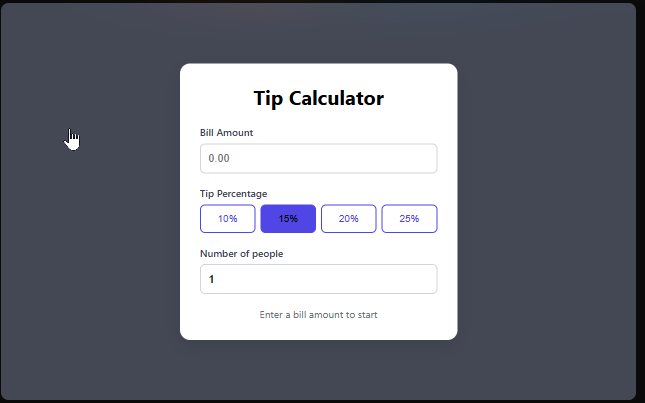

# Tip Calculator

[](https://github.com/SIRUP1999/tip-calculator/actions/workflows/ci.yaml)

A tip calculator that splits a bill, plus tip, between any number of people.

**Live demo:** [https://tip-calculator-ochre-three.vercel.app/](https://tip-calculator-ochre-three.vercel.app/)



## Features

- Enter a bill amount and pick a tip of 10%, 15%, 20% or 25%
- Split the total between any number of people
- See the tip, the total and the amount per person update instantly
- Results stay hidden until a bill is entered
- Invalid input can't break it: negative bills count as 0, and the number of people is always a whole number of at least 1
- One-click reset

## Tech used

- React
- Vite
- CSS
- GitHub Actions (CI) and Vercel (deployment)

## What I practiced

- Controlled inputs, where React state is the single source of truth
- Derived values: the tip, total and per-person amounts are calculated on every render, never stored in state
- Rendering lists with `.map()` and stable `key` props
- Conditional rendering and conditional class names
- Defensive calculations that stay correct however a user types

## Run it locally

```bash
git clone https://github.com/SIRUP1999/tip-calculator.git
cd tip-calculator
npm install
npm run dev
```

Then open the local link that Vite prints, usually `http://localhost:5173`.
